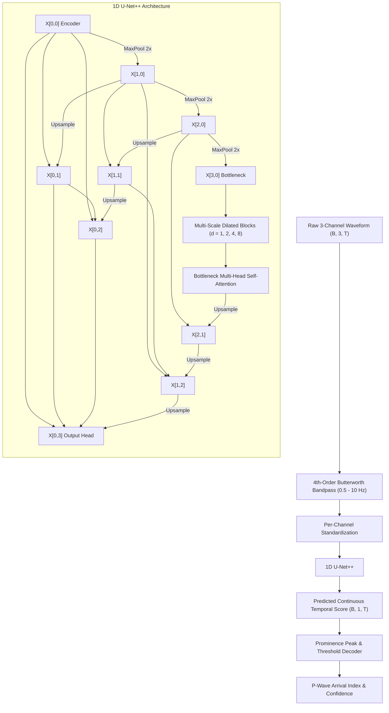

# Earthquake P-Wave Detection System Using U-Net++ and Gaussian Labeling

[](LICENSE)
[](https://www.python.org/)
[](https://pytorch.org/)
[](tests/)

> **A physics-informed deep learning framework for seismic P-wave arrival detection using 1D U-Net++, continuous Gaussian-distribution labeling, multi-scale dilated convolutions, and bottleneck multi-head self-attention.**

---

## 1. Introduction & Scientific Background

The early detection and high-precision arrival-time estimation of primary seismic waves (**P-waves**) is the foundational cornerstone of Earthquake Early Warning (EEW) systems. Because compressive P-waves travel faster than destructive shear (**S-waves**) and surface waves ($v_p \approx 1.73 \times v_s$ in typical crustal media), single-station detection within the initial few seconds after arrival provides critical warning time for civil protection, automated high-speed transit braking, and gas pipeline shutoffs.

Traditional energy-ratio algorithms (e.g., Short-Term Average / Long-Term Average [STA/LTA], Baer-Ulrich variance criteria, and polarization analysis) are notoriously vulnerable to cultural anthropogenic noise, ambient oceanic microseisms, emergent phase onsets, and poor signal-to-noise ratios (SNR).

This project implements an advanced deep learning framework inspired by recent seismological research:
> **"A Physics-Informed Deep Learning and Probabilistic Inference Framework for Real-Time Single-Station Earthquake Detection and Magnitude Estimation"**  
> *DOI: [10.21203/rs.3.rs-7479899/v1](https://doi.org/10.21203/rs.3.rs-7479899/v1)*

---

## 2. Problem Statement & Objectives

### The Problem
1. **Hard Binary Point Penalty**: Treating arrival picking as an impulse annotation ($y(t) = 1$ at arrival, $0$ elsewhere) causes extreme class imbalance ($1$ in $6,000$ points) and severely penalizes near-perfect picks with zero gradient feedback during backpropagation.
2. **Semantic Gap in Standard U-Nets**: Standard U-Net architectures concatenate shallow encoder features directly with deep decoder features, creating an optimization gap between fine-grained temporal onsets and semantic contextual abstractions.
3. **Multi-Scale Seismic Phase Characteristics**: High-frequency impulsive onsets are superimposed on long-period dispersive coda wave trains.

### Research Objectives
- Implement a genuine **1D U-Net++** featuring dense nested convolutional skip pathways ($X^{i,j}$) to bridge the semantic feature gap.
- Formulate continuous **Gaussian target distributions** to model observational arrival uncertainty physically and provide informative gradients.
- Incorporate **multi-scale dilated convolutions** ($d \in [1, 2, 4, 8]$) to expand the temporal receptive field exponentially without losing temporal onset precision.
- Integrate **Multi-Head Self-Attention (MHSA)** at the bottleneck to model long-range temporal dependencies without quadratic memory blowup.
- Establish an ablation testbed across four standardized architectures (**Model A through D**).

---

## 3. System Architecture

The pipeline processes 3-component seismic seismograms through physics-informed preprocessing, continuous target generation, 1D U-Net++ feature extraction, and temporal arrival decoding:



---

## 4. Mathematical Formulation

### A. Continuous Gaussian Target Generation
Instead of a Kronecker delta, the target label $Y(t)$ is generated as a continuous Gaussian distribution centered at the annotated arrival sample $t_p$:

$$Y(t) = \exp\left( -\frac{(t - t_p)^2}{2\sigma^2} \right)$$

Where:
- $t \in [0, T-1]$ is the temporal sample index ($T = 6,000$).
- $t_p$ is the ground-truth P-wave arrival sample.
- $\sigma$ is the standard deviation in samples (configurable, candidate experimental values $\sigma \in \{10, 20, 30, 40\}$).
- $Y(t_p) = 1.0$ at the arrival onset.

### B. U-Net++ Dense Nested Formulations
Let $x^{i,j}$ denote the output of node $X^{i,j}$, with depth $i \in \{0, \dots, D-1\}$ and nested skip column $j \in \{0, \dots, D-1-i\}$:

$$x^{i,j} = \mathcal{H}\left( \left[ \left[ x^{i,k} \right]_{k=0}^{j-1}, \, \mathcal{U}(x^{i+1, j-1}) \right] \right)$$

Where:
- $\mathcal{H}(\cdot)$ is a dual 1D convolutional block (`Conv1D - BatchNorm - GELU - Dropout - Conv1D - BatchNorm - GELU`).
- $\mathcal{U}(\cdot)$ is temporal linear interpolation upsampling.
- $[\cdot]$ denotes concatenation along the channel dimension.

### C. Multi-Scale Dilated Convolutions
Parallel dilated convolutions are applied at the bottleneck with dilation rates $d \in \{1, 2, 4, 8\}$:

$$Y_k = \text{Conv1D}(X, \text{dilation}=d_k, \text{padding}=\frac{d_k(k - 1)}{2})$$
$$Y = \text{Conv}_{1\times 1}\left(\left[ Y_1, Y_2, Y_4, Y_8 \right]\right) + X$$

This increases the temporal receptive field exponentially without downsampling onset transients.

### D. Multi-Head Self-Attention (MHSA)
At the bottleneck ($T_{\text{bottleneck}} = T / 2^{D-1}$):

$$\text{Attention}(Q, K, V) = \text{softmax}\left(\frac{QK^T}{\sqrt{d_k}}\right)V$$
- Query, Key, Value projections: $Q = X W_q, \, K = X W_k, \, V = X W_v$
- Residual bypass with Layer Normalization: $Y_{\text{MHSA}} = \text{Linear}(\text{Attention}(Q,K,V)) + X$

---

## 5. Architectural Configurations (Ablation Matrix)

| Model ID | Architecture Configuration | Dilated Convolutions | Attention (MHSA) | Deep Supervision | Config File |
|---|---|---|---|---|---|
| **Model A** | Baseline 1D U-Net++ | Disabled | Disabled | Disabled | `configs/baseline.yaml` |
| **Model B** | Dilated 1D U-Net++ | Enabled (`[1, 2, 4, 8]`) | Disabled | Disabled | `configs/dilated.yaml` |
| **Model C** | Attention 1D U-Net++ | Disabled | Enabled (4 heads) | Disabled | `configs/attention.yaml` |
| **Model D** | Proposed Enhanced Architecture | Enabled (`[1, 2, 4, 8]`) | Enabled (4 heads) | Enabled | `configs/enhanced.yaml` |

---

## 6. Dataset Structure & Provenance

### HDF5 Layout
```text
/
├── metadata    (N,)      - String / byte identifiers (e.g., station, event ID)
├── p_arrival   (N,)      - Integer: sample index of annotated P-wave arrival
├── s_arrival   (N,)      - Integer: sample index of annotated S-wave arrival
└── traces      (N, T, 3) - Float32: 3-component seismic waveforms
```

### Provenance Notice
- A local inspection archive is located at `STEAD/test.hdf5`.
- Audit metadata indicates curation by researcher Daniele Trappolini.
- **Scientific Integrity Rule**: In rigorous research, never train on held-out test datasets. The local `test.hdf5` is used exclusively for testing, validation, and benchmarking.
- The codebase supports seamless configuration of training archives (such as full STEAD or regional networks) via YAML.

---

## 7. Installation & Quickstart

### Prerequisites
- Python 3.9+ (tested on Python 3.9, 3.10, 3.11, 3.12, 3.13)
- PyTorch 2.0+ (CPU or CUDA GPU)

### 1. Clone & Set Up Environment
```bash
git clone https://github.com/example/earthquake-p-wave-detection.git
cd earthquake-p-wave-detection

python -m venv venv
source venv/bin/activate  # On Windows: venv\Scripts\activate

pip install -r requirements.txt
```

### 2. Run Test Suite
Verify environment, dataset fixtures, and model architectures:
```bash
pytest tests
```
*Expected: 26 unit and integration tests passing.*

---

## 8. Command-Line Interface (CLI)

### A. Inspect & Audit Dataset
Streamingly scans HDF5 files for NaNs, Infs, label ranges, and signal statistics:
```bash
python scripts/inspect_dataset.py --config configs/config.yaml
```

### B. Visualize Waveform & Phase Picks
Generates publication-ready 3-component seismograms and Gaussian target plots:
```bash
python scripts/visualize_waveform.py --record-index 0
```
*Plots saved to `results/visualizations/`.*

### C. Train Model
Train Model A (Baseline) or Model D (Enhanced) with Adam optimizer, StepLR decay, and early stopping:
```bash
python scripts/train_model.py --config configs/baseline.yaml
python scripts/train_model.py --config configs/enhanced.yaml --epochs 50 --batch-size 16
```
*Checkpoints saved to `checkpoints/best_model.pt` and loss curves to `results/`.*

### D. Single-Record Inference
Load a trained model checkpoint and predict P-wave arrival on a seismogram:
```bash
python scripts/predict.py --checkpoint checkpoints/best_model.pt --record-index 0
```

### E. Evaluate Model on Test Split
Compute Precision, Recall, F1-Score, MAE (in samples and ms), and residual distribution:
```bash
python scripts/evaluate_model.py --checkpoint checkpoints/best_model.pt --num-records 100
```

---

## 9. Interactive Research Notebooks

The `notebooks/` directory provides interactive Jupyter walkthroughs for each stage:
1. `notebooks/01_dataset_audit.ipynb`: Dataset integrity and streaming HDF5 verification.
2. `notebooks/02_waveform_analysis.ipynb`: 3-channel seismogram inspection and phase arrivals.
3. `notebooks/03_preprocessing.ipynb`: Butterworth filtering and normalization comparison.
4. `notebooks/04_gaussian_labeling.ipynb`: Continuous Gaussian target generation and width tuning ($\sigma$).
5. `notebooks/05_model_experiments.ipynb`: Architectural ablation and parameter analysis (Models A–D).
6. `notebooks/06_error_analysis.ipynb`: Residual distributions, timing tolerances, and noise robustness.

---

## 10. Phase 2 Extension: Bayesian Magnitude Estimation

As an optional research extension in `src/earthquake_detection/magnitude/`, initial 3-second P-wave displacement and cumulative velocity energy $E_p$ are coupled with an ensemble of **32 Markov Chain Monte Carlo (MCMC) walkers** to infer full posterior earthquake magnitude distributions under a Gutenberg-Richter prior $P(M) \propto 10^{-b M}$:

$$\log_{10}(P_d) = \alpha M + \beta \log_{10}(R) + \gamma + \epsilon$$

> **Research Note**: Deploying magnitude estimation requires calibrated regional attenuation coefficients $(\alpha, \beta, \gamma)$. This module provides the mathematical and sampling framework without imposing hardcoded uncalibrated empirical coefficients.

---

## 11. Scientific Limitations & Operational Notice

> [!CAUTION]
> **Research Implementation Notice**: This software is an independent scientific research implementation and is **NOT** a certified or operational earthquake early warning (EEW) system. It must not be deployed for life-safety-critical automation or civil protection alerts without independent seismological agency validation and certification.

- **Non-Causal Filtering**: Zero-phase filtering (`scipy.signal.sosfiltfilt`) eliminates phase distortion for offline retrospective benchmarking, but utilizes future samples. For real-time streaming, causal filtering must be enabled in the configuration (`zero_phase: false`).
- **Single-Station Limitations**: Hypocentral depth and fault rupture geometry cannot be determined from a single three-component seismometer without multi-station network cross-correlation.
- **Double-Integration Drift**: Double numerical integration of acceleration records to displacement can amplify low-frequency sensor baseline offsets; high-pass filtering is required.

---

## 12. References & Citations

If you use this repository in your research, please cite:

```bibtex
@article{earthquake_dl_framework_2024,
  title={A Physics-Informed Deep Learning and Probabilistic Inference Framework for Real-Time Single-Station Earthquake Detection and Magnitude Estimation},
  journal={ResearchGate / Research Square Preprints},
  year={2024},
  doi={10.21203/rs.3.rs-7479899/v1}
}

@article{zhou2018unetplusplus,
  title={UNet++: A Nested U-Net Architecture for Medical Image Segmentation},
  author={Zhou, Zongwei and Siddiquee, Md Mahfuzur Rahman and Tajbakhsh, Nima and Liang, Jianming},
  journal={Deep Learning in Medical Image Analysis},
  pages={3--11},
  year={2018},
  publisher={Springer}
}

@article{mousavi2019stead,
  title={STanford EArthquake Dataset (STEAD): A Global Data Set of Seismic Signals for AI},
  author={Mousavi, S. Mostafa and Sheng, Yixiao and Zhu, Weiqiang and Beroza, Gregory C.},
  journal={IEEE Access},
  volume={7},
  pages={179464--179476},
  year={2019},
  publisher={IEEE}
}
```

---

## 13. License

Distributed under the **MIT License**. See [LICENSE](LICENSE) for details.
