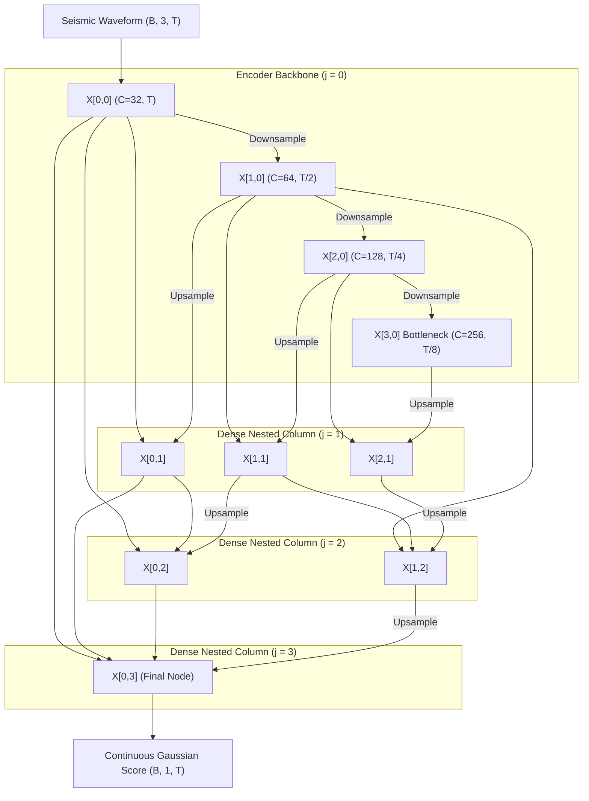

# 1D U-Net++ Architecture Specification

## 1. Topological Overview

The neural architecture implements a genuine 1D U-Net++ (Nested U-Net) specifically optimized for single-station temporal seismic phase picking.

Traditional 1D U-Net designs suffer from coarse semantic feature aggregation across expansive skip connections: early encoder features have shallow representations with high temporal resolution, whereas decoder features have deep semantic representations with coarse spatial resolution. U-Net++ solves this semantic gap through dense, nested convolutional skip pathways $X^{i,j}$.

---

## 2. Mathematical Node Formulation

Let $x^{i,j}$ denote the output tensor of node $X^{i,j}$, where:
- $i \in \{0, 1, \dots, D-1\}$ indexes the downsampling depth level.
- $j \in \{0, 1, \dots, D-1-i\}$ indexes the skip connection column along the nested dense branch.

The feature aggregation is formally computed as:

$$x^{i,j} = \mathcal{H}\left( \left[ \left[ x^{i,k} \right]_{k=0}^{j-1}, \, \mathcal{U}(x^{i+1, j-1}) \right] \right)$$

Where:
- $\mathcal{H}(\cdot)$ is a 1D convolutional block comprising two consecutive sequence layers: `[Conv1D(k=3) -> BatchNorm1D -> GELU -> Dropout -> Conv1D(k=3) -> BatchNorm1D -> GELU]`.
- $\mathcal{U}(\cdot)$ denotes temporal linear interpolation upsampling that precisely matches the temporal sequence length of level $i$.
- $[\cdot]$ denotes feature concatenation along the channel dimension.

---

## 3. Bottleneck Enhancements

### A. Multi-Scale Dilated Convolutions
Seismic waveforms exhibit multi-frequency phase characteristics (high-frequency onset transients superimposed on lower-frequency coda and mantle paths). At the bottleneck ($X^{D-1, 0}$), we introduce parallel dilated convolutional branches:

$$Y_k = \text{Conv1D}(X, \text{dilation}=d_k, \text{padding}=\frac{d_k(k_s - 1)}{2}), \quad d_k \in \{1, 2, 4, 8\}$$
$$Y = \text{Conv1x1}\left(\left[ Y_1, Y_2, Y_4, Y_8 \right]\right) + X$$

This increases the effective receptive field exponentially without losing temporal alignment or downsampling high-frequency phase onsets.

### B. Multi-Head Self-Attention (MHSA)
At the bottleneck, the temporal sequence length is reduced from $T=6000$ to $T_{\text{bottleneck}} = 6000 / 2^{D-1} = 750$ (for $D=4$). This downsampling enables exact self-attention without quadratic $O(T^2)$ memory bottlenecks:

$$\text{Attention}(Q, K, V) = \text{softmax}\left(\frac{QK^T}{\sqrt{d_k}}\right)V$$
- Projections: $Q = X W_q, \, K = X W_k, \, V = X W_v$
- LayerNorm and residual identity bypass: $Y_{\text{MHSA}} = \text{Linear}(\text{Attention}(Q,K,V)) + X$

---

## 4. Deep Supervision

When `deep_supervision = True`, auxiliary classification heads are attached to all top-level nodes $X^{0, j}$ for $j \in \{1, \dots, D-1\}$. The total training loss is:

$$\mathcal{L}_{\text{total}} = \sum_{j=1}^{D-1} w_j \cdot \mathcal{L}( \hat{Y}^{0,j}, Y )$$

During evaluation, the model outputs predictions strictly from the most refined nested head $X^{0, D-1}$.
